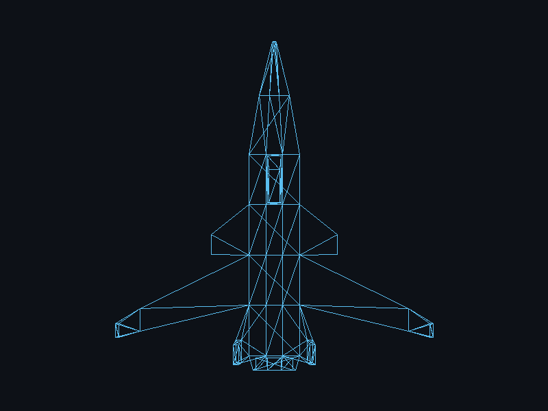

# Lab 4: Carga de modelos

Proyecto 1, parte 1: dibujar un modelo OBJ con mi propio renderer en Rust.



El modelo es una nave que hice en Blender a partir de un cubo, usando solo extrude, scale, rotate, inset y bevel. Está en `assets/nave.obj` y tiene 114 vértices y 224 triángulos.

## Cómo correr

```
cargo run --release
```

Se abre una ventana de 800x600 con la nave. Con `F12` se guarda la captura en `docs/screenshot.png`.

Para generar la captura sin abrir la ventana:

```
cargo run --release -- --screenshot
```

## Cómo funciona

```
Archivo OBJ -> vértices + índices -> triángulos -> líneas -> píxeles -> pantalla
```

1. **Cargar el OBJ** (`src/obj.rs`). Se lee el archivo línea por línea. Las líneas `v` se guardan en una lista de vértices y las líneas `f` en una lista de caras, donde cada cara tiene los 3 índices de sus vértices. Los índices del OBJ empiezan en 1, entonces se les resta 1.
2. **Recorrer los triángulos** (`render` en `src/main.rs`). Por cada cara se toman sus tres índices y con ellos se buscan los tres vértices en la lista.
3. **Pasar a pantalla**. Todavía no hay proyección 3D, así que solo se usan `x` y `y` de cada vértice. Se calcula el rectángulo que ocupa el modelo para escalarlo a un 80% de la ventana y moverlo al centro. La `y` se invierte porque en la pantalla crece hacia abajo.
4. **Dibujar** (`src/triangle.rs`). La función `triangle` hace tres llamadas a `line`, que usa Bresenham (`src/line.rs`). Cada línea pinta píxeles en el framebuffer.
5. **Mostrar**. El framebuffer se copia a una textura de raylib y se dibuja en la ventana. Raylib solo se usa para la ventana; no se usa para cargar ni dibujar el modelo.

El OBJ está exportado con la nave vista desde arriba, para que con solo `x` y `y` se distinga bien su forma: la nariz, las alas y el motor.

## Estructura

```
assets/nave.obj, nave.mtl   modelo
docs/screenshot.png         captura
src/main.rs                 ventana, escala/centrado y recorrido de triángulos
src/obj.rs                  cargador de OBJ (vértices + índices)
src/triangle.rs             triangle con 3 líneas
src/line.rs                 Bresenham
src/framebuffer.rs          buffer de píxeles y guardado en PNG
```
